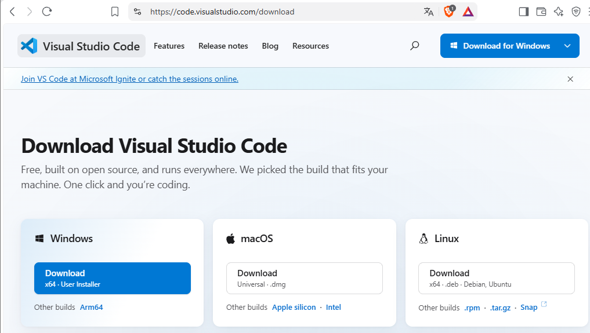
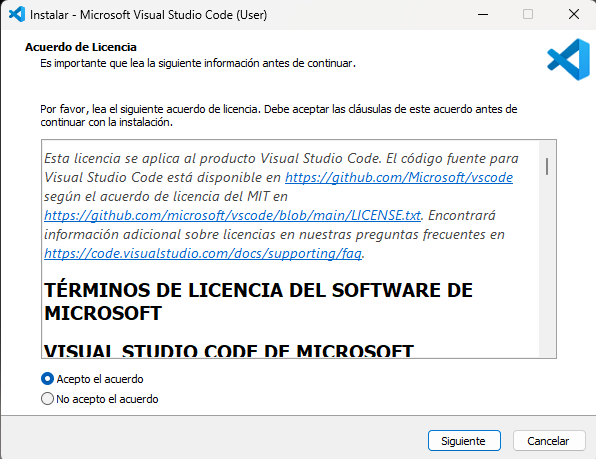
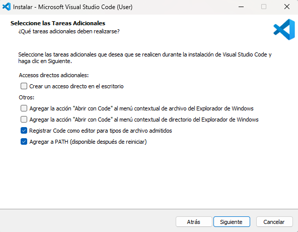
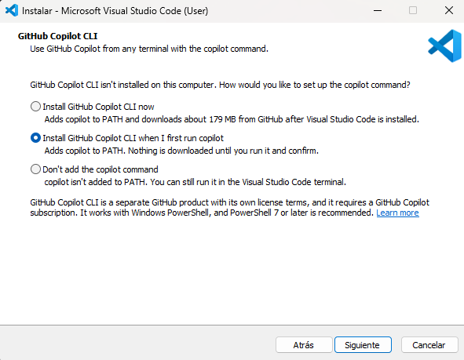
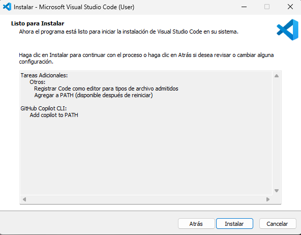
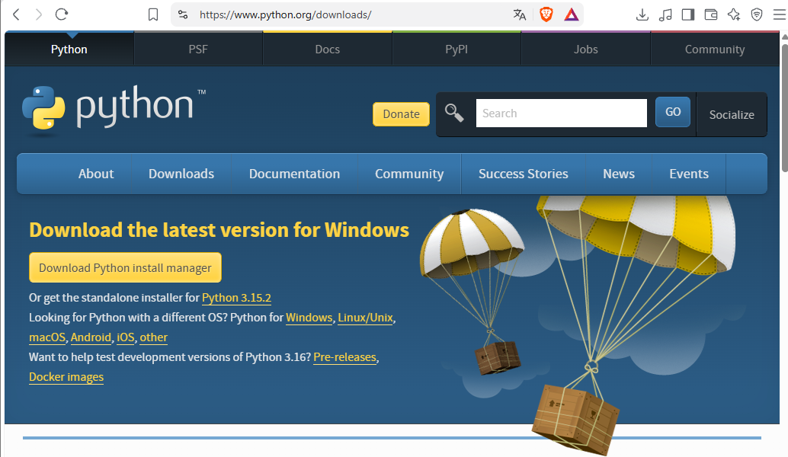
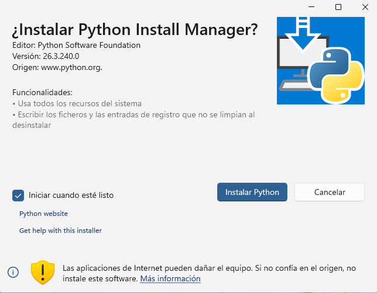
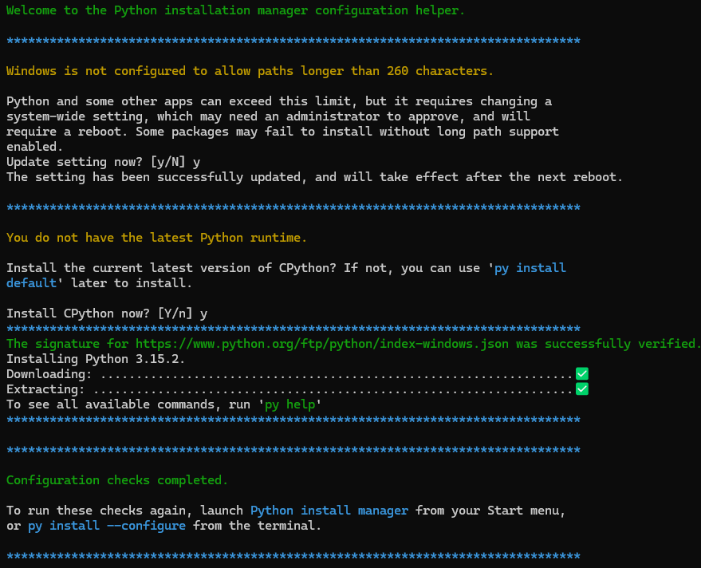
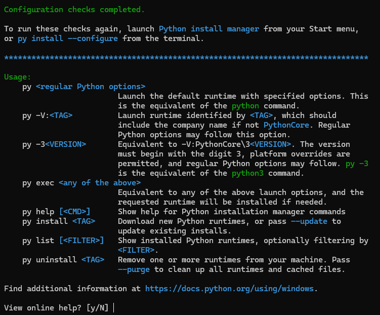

# Comparación de entornos de desarrollo (IDE)

## 1. Organización y elección de los entornos

### 1.1. Integrantes del grupo

| Integrante | Responsabilidad temporal |
|---|---|
| Ismael | Coordinación de evidencias |
| Dante | Comprobación de licencias y versiones |
|  | Revisión de módulos, plugins y extensiones |
| Integrante 4 | Revisión de construcción y artefactos |
| Integrante 5 | Preparación de la exposición |

Las responsabilidades son temporales. Todos los integrantes deben realizar individualmente las pruebas correspondientes.

### 1.2. Entornos seleccionados

| Característica | Entorno 1 | Entorno 2 |
|---|---|---|
| Producto | Python | IntelliJ IDEA (Kotlin) |
| Versión | 3.14.8 | 150.0.14 |
| Sistema operativo | Windows11 | Windows11 |
| Fuente oficial | https://www.python.org/downloads/ | https://www.jetbrains.com/idea/download/ |

### 1.3. Condiciones de comparación

- Mismo código fuente cuando se comparen los entornos.
- Misma versión de Python o JDK siempre que sea posible.
- Mismo tipo de tarea.
- Mismo equipo informático.
- Mismas condiciones de ejecución.

**Limitaciones detectadas:**

[Indicar las condiciones que no se hayan podido mantener.]

---

# 2. Instalación de los entornos (CE 2.a)

## 2.1. Ficha de los entornos (E-2A-01)

### Entorno 1

| Campo | Información |
|---|---|
| Producto | Visual Studio Code |
| Edición | Estandar |
| Versión | 1.147.0 |
| Licencia | - |
| Sistema operativo | Windows 11 |
| Fuente de descarga | https://code.visualstudio.com/ |
| Componentes seleccionados | - |

### Entorno 2

| Campo | Información |
|---|---|
| Producto | Python |
| Edición | Python3 |
| Versión | 3.14.8 |
| Licencia | - |
| Sistema operativo | Windows11 |
| Fuente de descarga | https://www.python.org/downloads/ |
| Componentes seleccionados | - |

## 2.2. Proceso de instalación (E-2A-02)

### Entorno 1

1. Descarga desde la página oficial.
2. Inicio del instalador.
3. Selección de componentes.
4. Configuración de opciones.
5. Finalización de la instalación.

**Evidencias:**
- 
- 
- 
- 
- 

### Entorno 2

1. Descarga desde la página oficial.
2. Inicio del instalador.
3. Selección de componentes.
4. Configuración de opciones.
5. Finalización de la instalación.

**Evidencias:**

- 
- 
- 
- 
- 

## 2.3. Comprobación final (E-2A-03)

| Comprobación | Entorno 1 | Entorno 2 |
|---|---|---|
| Se inicia correctamente | Sí | Sí |
| Versión comprobada | 1.147.0 | 3.15.2 |
| Coincide con la registrada | Sí | Sí |

**Evidencias:**

- [Versión del entorno 1](Evidencia/Personalizacion/Version_VS.png)
- [Versión del entorno 2](Evidencia/Comandos/Comando1.png)

## 2.4. Preguntas

**P-2A-01. ¿Qué diferencias observaste en el proceso y en las opciones de instalación?**

[Respuesta.]
Realmente no existe una gran diferencia entre instalar Visual Studio Code y Python3, exceptuando, en mi caso, que la parte para configurar el entorno el VS te daba una interfaz con la interactuar para configurar el entorno a tu gusto, mientras que Python se hace atraves de la cmd

**P-2A-02. ¿Qué licencia, edición y componentes tiene cada entorno?**

[Respuesta.]
-

**P-2A-03. ¿Qué ventajas o limitaciones aporta cada modelo de distribución para el proyecto elegido?**

[Respuesta.]
Las ventajas de python es que es de codigo abierto, gratuito, cuenta con una cominidad enorme y puede modificar y redistribuir codigo. Y sus limitaciones es que no hay soporte tecnico oficial y la calidad y mantenimiento de los paquetes varían.

Y las ventajas de VS es que es gratuito, ampliable atraves de extensiones y respaldado por microsoft. Y sus limitaciones son que las licencias del binario restringen la redistribucion y modificacion, algunas extenciones son de "pago" y dependes de Microsoft para las actualizaciones del marketplace
---

# 3. Gestión de módulos, plugins y extensiones (CE 2.b)

## 3.1. Complemento elegido (E-2B-01)

Necesidad común: [Python / Kotlin / pruebas / análisis de código / formateo].

| Característica | Entorno 1 | Entorno 2 |
|---|---|---|
| Nombre del complemento | Visual Studio Code | JetBrains(IntelliJ IDEA) |
| Tipo | Extensión | Plugin |
| Versión | 1.147.8 | 3.9.1 |
| Permisos | [Permisos] | [Permisos] |
| Documentación | [URL] | [URL] |

## 3.2. Instalación y funcionamiento (E-2B-02)

### Entorno 1

- Instalación: En el menu principal de VS ahi un apartado de extensiones en el cual puedes instalar todas las extensiones que desees y pudiendo desactivarla y activarla a voluntad.
- Prueba realizada: La prueba en VS sera realizada con extensiones de python y la prueba consiste en imprimir en consola un mensaje simple.

**Evidencias:**

- [Estado anterior](Evidencia/Personalizacion/Extensiones_VS1.png)
- [Instalación](Evidencia/Personalizacion/Extensiones_VS2.png)
- [Instalación](Evidencia/Personalizacion/Extensiones_VS4.png)
- [Funcionamiento](Evidencia/Personalizacion/Extensiones_VS3.png)

### Entorno 2

- Instalación: Al entrar en el inicio de IntelliJ IDEA en "Files" -> "Plugins" y te redirigira al marketplace para instalar todos los plugins que quieras.
- Prueba realizada: Una prueba sencilla en el que el programa imprime un mensaje.

**Evidencias:**

- [Procedimiento](Evidencia/Personalizacion/Plugins_IDEA1.png)
- [Procedimiento](Evidencia/Personalizacion/Plugins_IDEA2.png)
- [Instalación](Evidencia/Personalizacion/Plugins_IDEA3.png)
- [Configuración y funcionamiento](Evidencia/Personalizacion/Plugins_IDEA4.png)

## 3.3. Desactivación o eliminación (E-2B-03)

| Operación | Entorno 1 | Entorno 2 |
|---|---|---|
| Complemento desactivado o eliminado | desactivado | desactivado |
| Proyecto sigue funcionando | No | No |

**Evidencias:**

- [Estado posterior del entorno 1](Evidencia/Personalizacion/Extensiones_VS5.png)
- [Estado posterior del entorno 2](Evidencia/Personalizacion/Plugins_IDEA5.png)
- [Estado posterior del entorno 2](Evidencia/Personalizacion/Plugins_IDEA6.png)

## 3.4. Preguntas

**P-2B-01. ¿Cómo se añade y se elimina o desactiva el complemento en cada entorno?**

[Respuesta.]
En VS desde el apartado de extensiones y desde IntelliJ IDEA en "Files" -> "Plugins"

**P-2B-02. ¿Qué función aporta y qué herramienta externa necesita, si la necesita?**

[Respuesta.]
Python en VS aporta la sintaxis, depuracion, ejecucion de archivo, navegacion de codigo y gestion de entornos virtuales

IntelliJ IDEA (Java) aporta el analisis del código mientras se escribe y marca errores, code smells y vulnerabilidades directamente en el editor.

En caso de VS se necesita una extension para poder correr apropiadamente python y para IntelliJ IDEA se necesita un plugin para una ejecucion correcta en el codigo

**P-2B-03. ¿Qué riesgos de mantenimiento, permisos o compatibilidad has comprobado?**

[Respuesta.]
Por el momento no existe ningun problema de mantenimiento, ya que las actualizaciones son en ambos entornos automaticas, muy raramente necesitaras un permiso de nada ni nadie para instalar una extension o plugin y en la compatibilidad tampoco a habido un problema 

---

# 4. Personalización y automatización (CE 2.c)

## 4.1. Personalización (E-2C-01)

### Entorno 1

- Personalización realizada: [Tema, fuente, paneles o atajos].
- Fondo: haces "CTRL + P" y escribes "Preferences: Color Theme" instala la extension y podras personalizar a gusto tu VS.
- Fuente: haces "CTRL + P" y escribes "Preferences: Open User Settings (JSON)" y cuando hagas click en la opcion copias esta linea -> "editor.fontSize": 16 haciendo que la letra en VS se más grande o pequeña.
- Paneles o Atajos: En este orden haces "CTRL + K" y "CTRL + S" y se abrira una ventana con todos los atajos para que puedar ser personalizados.
- Antes: [Captura](Evidencia/Personalizacion/Personalizar_VS1.png)
- Después: [Captura](Evidencia/Personalizacion/Personalizar_VS2.png).

### Entorno 2

- Personalización realizada: [Tema, fuente, paneles o atajos].
- Fondo: Ve a "Files" y "Settings" en la primera opcion "Appearance & Behavior" podras cambiar el fondo a tu gusto.
- Fuente: Ve a "Files" y "Settings" en la primera opcion "Appearance & Behavior" podras cambiar el formato y tamaño de la letra.
- Paneles o Atajos: Ve a "Files" -> "Settings" -> "Keymap" en este apartado puedes editar y personalizar todos los atajos que desees
- Antes: [Captura](Evidencia/Personalizacion/Personalizar_IDEA1.png).
- Después: [Captura](Evidencia/Personalizacion/Personalizar_IDEA2.png).

## 4.2. Automatización configurada (E-2C-02)

### Entorno 1

| Campo | Información |
|---|---|
| Codigo | [Codigo](Evidencia/Python/Codigo_PY1.png) |
| Comando | python prueba.py |
| Directorio de trabajo | C:\Users\cash\proyectos\python-prueba |
| Intérprete/JDK | [Versión y ruta] |
| Resultado | [Resultado](Evidencia/Python/Codigo_PY2.png) |

### Entorno 2

| Campo | Información |
|---|---|
| Codigo | [Codigo] |
| Comando | [Comando real] |
| Directorio de trabajo | [Ruta] |
| Intérprete/JDK | [Versión y ruta] |
| Resultado | [Resultado] |

## 4.3. Ejecución verificable (E-2C-03)

| Comprobación | Entorno 1 | Entorno 2 |
|---|---|---|
| Primera ejecución | [Resultado] | [Resultado] |
| Segunda ejecución | [Resultado] | [Resultado] |
| Salida coherente | [Sí/No] | [Sí/No] |
| Archivos modificados | [Archivos] | [Archivos] |
| Disparador | [Manual/Automático] | [Manual/Automático] |

**Evidencias:**

- [Ejecución del entorno 1](evidencias/2C/entorno1-ejecucion.png)
- [Ejecución del entorno 2](evidencias/2C/entorno2-ejecucion.png)

## 4.4. Preguntas

**P-2C-01. ¿Qué parte de la personalización es personal y cuál podría compartir el equipo?**

[Respuesta.]
-

**P-2C-02. ¿Qué pasos manuales ahorra la automatización?**

[Respuesta.]
El ejecutar atraves de la interfaz el codigo

**P-2C-03. ¿Qué riesgo tendría ejecutarla con un intérprete, una ruta o una versión distinta?**

[Respuesta.]
Corres el riesgo de toparte de con un problema de compatibilidad y versiones

---

# 5. Actualización del entorno (CE 2.d)

## 5.1. Inventario de versiones (E-2D-01)

| Componente | Entorno 1 | Entorno 2 |
|---|---|---|
| IDE | 1.98 (Visual Studio Code) | 2025.3 (IntelliJ IDEA) |
| Plugin/extensión | - | - |
| Python/JDK | 3.15.2 | 25.0.5.1 |
| Sistema de construcción | Maven | Gradle |
| Sistema operativo | Windows11 | Windows11 |

## 5.2. Política de actualización (E-2D-02)

### Entorno 1

- Configuración: [Descripción](Evidencia/Personalizacion/IDE_VS1.png).
- Política elegida: default.
- Justificación: Para mi es la opcion más estable y confiable que se puede llegar a elegir

### Entorno 2

- Configuración: [Descripción](Evidencia/IDEA/Menu_IDEA1.png).
- Política elegida: automatico.
- Justificación: seleccioné el automatico porque a pesar de poder desembocar en un problema de compatibilidad, es la opcion más sostenible con la que cuenta IntelliJ IDEA

## 5.3. Comprobación y decisión (E-2D-03)

| Comprobación | Entorno 1 | Entorno 2 |
|---|---|---|
| Actualizaciones disponibles | [Resultado](Evidencia/Visual/Actualizar_VS1.png). | [Resultado](Evidencia/IDEA/Actualizar_IDEA1.png). |
| Versión disponible | [Versión](Evidencia/Visual/Actualizar_VS2.png) | [Versión](Evidencia/IDEA/Actualizar_IDEA2.png) |
| Actualización realizada | Sí | Sí |
| Motivo de la decisión | Nuevas extensiones, mejoras en la interfaz y seguridad | Mejora en las herramientas de depuracion, mejores plugins y seguridad |

**Evidencias:**

- [Comprobación de actualizaciones del entorno 1](Evidencia/Visual/Actualizar_VS2.png)
- [Comprobación de actualizaciones del entorno 2](Evidencia/IDEA/Actualizar_IDEA2.png)

## 5.4. Comprobación posterior (E-2D-04)

[Describir el reinicio, la comprobación del proyecto y la ejecución de la misma tarea de la sección 4.]
-

## 5.5. Preguntas

**P-2D-01. ¿Qué componente controla la actualización del IDE y cuál controla la de sus plugins o extensiones?**

[Respuesta.]
Las actualizaciones de la IDE son controladar por el update service el cual comprueba constantemente por actualizaciones y las extensiones y plugins son controladas por el administrador de extensiones

**P-2D-02. ¿Por qué has elegido una política automática o manual?**

[Respuesta.]
He decidido la politica automatica ya que la mayoria de actualizaciones no afectarian a mis trabajos, pero en caso de hacer un proyecto mas grande posiblemente me decantaria más por la opcion manual, hasta el momento preferire la politica automatica

**P-2D-03. ¿Por qué es importante mantener el entorno actualizado y qué riesgos tiene actualizarlo sin comprobar la compatibilidad?**

[Respuesta.]
Pueden haber problemas en la seguridad y muy probablemente perder la compatibilidad con algunas extensiones o plugins haciendo que tu trabajo se vuelva obsoleto hasta actualizar el IDE

**P-2D-04. ¿Qué comprobaciones harías antes de aceptar una actualización importante?**

[Respuesta.]
Comprobar la compatibilidad con mis extensiones y plugins, los cambios que incluye y si despues de la actualizacion mi proyecto seguira intacto

---


# 4.6. Parte individual: dos lenguajes en un mismo IDE (CE 2.e)

## E-2E-01 — Código y configuración

Para realizar esta actividad se han creado dos proyectos o módulos dentro del mismo IDE, uno utilizando Java y otro utilizando Kotlin/JVM.

**Configuración del entorno:**

- IDE utilizado: IntelliJ IDEA.
- Versión del IDE: [Indicar versión](Evidencia/IDEA/Actualizar_IDEA2.png).
- JDK instalado: [Indicar versión](Evidencia/IDEA/IDE_IDEA1.png).
- Versión de Java: [Indicar versión](Evidencia/IDEA/IDE_IDEA2.png).
- Versión de Kotlin/JVM: [Indicar versión](Evidencia/IDEA/IDE_IDEA3.png).
- Sistema de construcción: Gradle.
- Sistema operativo: Windows11.

**Archivos utilizados:**

- `Main.java`: programa de cuenta atrás desarrollado en Java.
- `Main.kt`: programa de cuenta atrás desarrollado en Kotlin.

**Código Java (`Main.java`):**

```java
public class Main {
    public static void main(String[] args) {
        for (int i = 10; i >= 0; i--) {
            System.out.println(i);
        }
        System.out.println("¡Despegue!");
    }
}
```

**Código Kotlin (`Main.kt`):**

```kotlin
fun main() {
    for (i in 10 downTo 0) {
        println(i)
    }
    println("¡Despegue!")
}
```

## E-2E-02 — Ejecución

Se ejecutan ambos programas desde sus respectivas configuraciones de ejecución del IDE.

**Configuración de ejecución de Java:**

- Nombre de la configuración: Main.java
- Clase principal: Main.
- JDK utilizado: [Indicar versión](Evidencia/IDEA/IDE_IDEA1.png).

**Configuración de ejecución de Kotlin:**

- Nombre de la configuración: Main.Kt
- Clase o función principal: Main.
- JDK utilizado: [Indicar versión](Evidencia/IDEA/IDE_IDEA1.png).

**Salida obtenida en Java:**

[Pegar aquí la salida completa](Evidencia/IDEA/Java_IDEA1.png).


**Salida obtenida en Kotlin:**

[Pegar aquí la salida completa](Evidencia/IDEA/Kotlin_IDEA1.png).


**Evidencias:**

- [Insertar captura de la ejecución de Java](Evidencia/IDEA/Java_IDEA2.png).
- [Insertar captura de la ejecución de Kotlin](Evidencia/IDEA/Kotlin_IDEA2.png).

## E-2E-03 — Construcción y artefactos

Se realiza una construcción explícita de ambos proyectos para comprobar qué archivos compilados y artefactos genera cada lenguaje.

**Construcción de Java:**

- Comando o tarea utilizada: [Indicar comando](Evidencia/IDEA/Java_IDEA3.png).
- Archivos generados: [Indicar archivos `.class`, JAR u otros](Evidencia/IDEA/Java_IDEA4.png).

**Construcción de Kotlin:**

- Comando o tarea utilizada: [Indicar comando](Evidencia/IDEA/Kotlin_IDEA3.png).
- Archivos generados: [Indicar archivos `.class`, JAR u otros](Evidencia/IDEA/Kotlin_IDEA4.png).

**Evidencias:**

- [Insertar captura de la construcción de Java](Evidencia/IDEA/Java_IDEA5.png).
- [Insertar captura de la construcción de Kotlin](Evidencia/IDEA/Kotlin_IDEA5.png).
- [Insertar captura de las carpetas de salida y los artefactos generados](Evidencia/IDEA/Java,Kotlin_IDEA1.png).

## P-2E-01. ¿Qué partes de la cadena de construcción son diferentes entre los dos lenguajes?

En general la construccion que yo he realizado entre java y kotlin son muy diferentes del uno y del otro, esto notandose más cuando nos referimos a los comandos, tambien en el tema del compilador, porque en mi caso he tenido que instalar un compilador de kotlin para poder asi compilarlo y realizar el ejercicio

## P-2E-02. ¿Qué configuraciones y artefactos genera el IDE en cada caso?

- En java se genera un .java que pasa a un .class atraves del compilador javac 
- En kotlin se genera un .kt que pasa a un .jar o .class por el compilador kotlinc

## P-2E-03. ¿Qué diferencia hay entre la salida de Run y el resultado de Build?

La salida Run sirve para ejecutar el programa y mostrar su resultado en la consola del IDE. Mientras que el Build sirve para compilar el proyecto, comprobar que no existen errores de compilación y generar los archivos objetos, como los .class o .jar, sin tener que ejecutar el programa.

---

# 4.7. Parte individual: mismo código en dos entornos (CE 2.f)

## E-2F-01 — Código y herramienta común

Para realizar esta actividad se utiliza un único archivo `main.py` en dos entornos de desarrollo diferentes, manteniendo exactamente el mismo contenido.

**Código utilizado (`main.py`):**

```python
for i in range(10, -1, -1):
    print(i)
print("¡Despegue!")
```

**Configuración de los entornos:**

| Característica | IDE 1 | IDE 2 |
|---|---|---|
| Nombre del IDE | Visual Studio Code | Intellij IDEA |
| Versión | [Indicar](Evidencia/Visual/Actualizar_VS2.png) | [Indicar](Evidencia/IDEA/version_IDEA1.png) |
| Sistema operativo | Windows11 | Windows11 |
| Versión de Python | [Indicar](Evidencia/Visual/versionPY_VS1.png) | [Indicar](Evidencia/IDEA/versionPY_IDEA1.png) |
| Entorno virtual | - | [Indicar](Evidencia/IDEA/python_IDEA1.png) |

Se comprueba que el contenido del archivo `main.py` es idéntico en ambos entornos.

**Evidencias:**

- [Insertar captura del archivo abierto en el IDE 1](Evidencia/Visual/IDE_VS1.png).
- [Insertar captura del mismo archivo abierto en el IDE 2](Evidencia/IDEA/Intell_IDEA1.png).

## E-2F-02 — Ejecución y depuración

Se selecciona el mismo intérprete de Python en ambos IDE y se ejecuta el archivo `main.py`.

**Datos de ejecución en el IDE 1:**

- Intérprete seleccionado: [Indicar].
- Versión de Python: [Indicar].
- Ruta del intérprete: [Indicar].
- Configuración de ejecución: [Indicar].
- Comando utilizado: [Indicar].

**Salida obtenida:**

```text
[Pegar aquí la salida completa del IDE 1]
```

**Datos de ejecución en el IDE 2:**

- Intérprete seleccionado: [Indicar].
- Versión de Python: [Indicar].
- Ruta del intérprete: [Indicar].
- Configuración de ejecución: [Indicar].
- Comando utilizado: [Indicar].

**Salida obtenida:**

```text
[Pegar aquí la salida completa del IDE 2]
```

**Prueba de depuración:**

Se coloca un punto de interrupción dentro del bucle para observar cómo cambia el valor de la variable `i` durante la ejecución.

- Resultado de la depuración en el IDE 1: [Describir].
- Resultado de la depuración en el IDE 2: [Describir].
- Diferencias observadas: [Describir].

**Evidencias:**

- [Insertar captura de ejecución en el IDE 1].
- [Insertar captura de ejecución en el IDE 2].
- [Insertar captura del punto de interrupción en el IDE 1].
- [Insertar captura del punto de interrupción en el IDE 2].

## E-2F-03 — Construcción común

Para comprobar la generación de artefactos compilados en ambos entornos, se utiliza el mismo archivo Java `Main.java`, con idéntico contenido y el mismo JDK.

**Código utilizado (`Main.java`):**

```java
public class Main {
    public static void main(String[] args) {
        for (int i = 10; i >= 0; i--) {
            System.out.println(i);
        }
        System.out.println("¡Despegue!");
    }
}
```

**Configuración común:**

- JDK utilizado: [Indicar versión].
- Ruta del JDK: [Indicar ruta].
- Archivo fuente: `Main.java`.
- Nombre del artefacto: `cuenta-atras.jar`.
- Secuencia de construcción: [Indicar comandos].

**Comandos utilizados:**

```bash
javac -d out Main.java

jar --create --file cuenta-atras.jar --main-class Main -C out .

java -jar cuenta-atras.jar
```

**Construcción en el IDE 1:**

- Comando o tarea ejecutada: [Indicar].
- Carpeta de salida: [Indicar].
- Artefacto generado: [Indicar].
- Resultado de la construcción: [Indicar].

**Construcción en el IDE 2:**

- Comando o tarea ejecutada: [Indicar].
- Carpeta de salida: [Indicar].
- Artefacto generado: [Indicar].
- Resultado de la construcción: [Indicar].

**Evidencias:**

- [Insertar captura de la construcción en el IDE 1].
- [Insertar captura de la construcción en el IDE 2].
- [Insertar captura de los archivos generados].

## E-2F-04 — Verificación del artefacto

Se comprueba que los dos entornos han generado el archivo JAR y que ambos artefactos contienen el programa compilado.

**Verificación del JAR del IDE 1:**

- Ubicación del archivo: [Indicar ruta].
- Contenido del JAR: [Indicar].
- Clase principal del manifiesto: [Indicar].
- Salida al ejecutar el JAR: [Pegar salida].
- Huella SHA-256: [Indicar].

**Verificación del JAR del IDE 2:**

- Ubicación del archivo: [Indicar ruta].
- Contenido del JAR: [Indicar].
- Clase principal del manifiesto: [Indicar].
- Salida al ejecutar el JAR: [Pegar salida].
- Huella SHA-256: [Indicar].

**Comandos de comprobación:**

Consultar el contenido del JAR:

```bash
jar tf cuenta-atras.jar
```

Calcular la huella SHA-256 en Linux o macOS:

```bash
sha256sum cuenta-atras.jar
```

Calcular la huella SHA-256 en Windows:

```powershell
Get-FileHash cuenta-atras.jar -Algorithm SHA256
```

**Comparación de los artefactos:**

[Describir aquí si los archivos generados tienen el mismo contenido, si sus manifiestos coinciden y si ambos producen la misma salida al ejecutarse.]

**Evidencias:**

- [Insertar captura del contenido del JAR del IDE 1].
- [Insertar captura del contenido del JAR del IDE 2].
- [Insertar captura de las huellas SHA-256].
- [Insertar captura de la ejecución de ambos JAR].

## P-2F-01. Explica las diferencias que observes en la preparación, la ejecución, la depuración, la configuración y la reproducibilidad.

[Explicar aquí las diferencias observadas entre ambos entornos durante la preparación del proyecto, la selección del intérprete, la ejecución del código, la depuración y la construcción de los artefactos.

Indicar qué diferencias corresponden únicamente a la interfaz del IDE y cuáles afectan realmente a la configuración o al proceso de desarrollo.

Comentar también si se han obtenido resultados reproducibles utilizando el mismo código, las mismas herramientas y los mismos comandos.]

## P-2F-02. ¿Qué entorno te ha resultado más cómodo o eficiente para ejecutar el mismo código y por qué?

[Indicar cuál de los dos entornos ha resultado más cómodo y justificar la elección teniendo en cuenta aspectos como:

- Facilidad de configuración del intérprete o JDK.
- Número de pasos necesarios para ejecutar el programa.
- Integración de la terminal.
- Facilidad para utilizar el depurador.
- Organización de las herramientas.
- Facilidad para construir y localizar los artefactos.

Justificar la elección utilizando las pruebas realizadas durante la actividad.]


# 4.8. Parte grupal: comparación y análisis (CE 2.g)

## E-2G-01 — Consolidación

Se reúnen las evidencias obtenidas individualmente por los integrantes del grupo para realizar una comparación conjunta de los dos entornos de desarrollo seleccionados.

Antes de elaborar la tabla comparativa, se revisan los resultados y se resuelven las posibles discrepancias entre las pruebas realizadas.

**Datos de los entornos seleccionados:**

- Entorno 1: [Indicar nombre, edición y versión].
- Entorno 2: [Indicar nombre, edición y versión].

**Integrantes del grupo:**

- [Integrante 1].
- [Integrante 2].
- [Integrante 3].
- [Integrante 4].
- [Añadir más integrantes si es necesario].

**Evidencias recopiladas:**

- [Indicar evidencias del primer entorno].
- [Indicar evidencias del segundo entorno].
- [Indicar pruebas realizadas en ambos entornos].

**Discrepancias encontradas y resolución:**

[Describir las diferencias entre los resultados individuales y explicar cómo se han comprobado o resuelto.]

Las características que no se hayan podido comprobar se indicarán como «no comprobado» y las mediciones que no se hayan realizado se indicarán como «no medido».

## E-2G-02 — Tabla comparativa

Se realiza una comparación entre los dos entornos de desarrollo utilizados, teniendo en cuenta sus características, herramientas, posibilidades de configuración y resultados obtenidos durante las actividades anteriores.

| Característica | Entorno 1: [Nombre] | Entorno 2: [Nombre] |
|---|---|---|
| Licencia | [Indicar] | [Indicar] |
| Edición | [Indicar] | [Indicar] |
| Sistema operativo | [Indicar] | [Indicar] |
| Proceso de instalación | [Describir] | [Describir] |
| Lenguajes probados | [Indicar] | [Indicar] |
| Frameworks probados | [Indicar] | [Indicar] |
| Módulos disponibles | [Describir] | [Describir] |
| Plugins o extensiones | [Indicar] | [Indicar] |
| Dependencia de herramientas externas | [Describir] | [Describir] |
| Editor de código | [Describir] | [Describir] |
| Autocompletado | [Describir] | [Describir] |
| Diagnóstico de errores | [Describir] | [Describir] |
| Refactorización | [Describir] | [Describir] |
| Depuración | [Describir] | [Describir] |
| Pruebas | [Describir] | [Describir] |
| Control de versiones | [Describir] | [Describir] |
| Personalización | [Describir] | [Describir] |
| Automatización | [Describir] | [Describir] |
| Actualización | [Describir] | [Describir] |
| Mantenimiento | [Describir] | [Describir] |
| Construcción de proyectos | [Describir] | [Describir] |
| Artefactos generados | [Indicar] | [Indicar] |
| Reproducibilidad | [Describir] | [Describir] |
| Rendimiento | [Indicar mediciones o «no medido»] | [Indicar mediciones o «no medido»] |
| Accesibilidad | [Describir] | [Describir] |
| Ventajas principales | [Indicar] | [Indicar] |
| Limitaciones | [Indicar] | [Indicar] |
| Proyecto recomendado | [Indicar] | [Indicar] |

## E-2G-03 — Origen de las funciones

Se identifica el origen de las principales características de cada entorno para distinguir las herramientas que incorpora el IDE de aquellas que necesitan complementos o programas externos.

Se utilizarán las siguientes categorías:

- **Integrada:** función incluida directamente en el IDE.
- **Extensión o plugin:** función añadida mediante un complemento.
- **Herramienta externa:** función realizada por un programa independiente.
- **No disponible:** función que el entorno no ofrece.
- **No comprobada:** función cuyo funcionamiento no se ha verificado.

| Característica | Entorno 1 | Entorno 2 |
|---|---|---|
| Editor de código | [Indicar origen] | [Indicar origen] |
| Autocompletado | [Indicar origen] | [Indicar origen] |
| Diagnóstico de errores | [Indicar origen] | [Indicar origen] |
| Refactorización | [Indicar origen] | [Indicar origen] |
| Depuración | [Indicar origen] | [Indicar origen] |
| Ejecución de pruebas | [Indicar origen] | [Indicar origen] |
| Control de versiones | [Indicar origen] | [Indicar origen] |
| Gestión de plugins | [Indicar origen] | [Indicar origen] |
| Automatización | [Indicar origen] | [Indicar origen] |
| Construcción de proyectos | [Indicar origen] | [Indicar origen] |
| Gestión de dependencias | [Indicar origen] | [Indicar origen] |
| Actualizaciones | [Indicar origen] | [Indicar origen] |

**Observaciones:**

[Explicar qué características necesitan herramientas externas, cuáles dependen de plugins y cuáles vienen incorporadas en cada IDE.]

## E-2G-04 — Conclusión grupal

Después de revisar las actividades individuales y comparar los resultados obtenidos, se realiza una conclusión conjunta sobre los dos entornos de desarrollo.

**Coincidencias entre los integrantes:**

[Indicar los aspectos en los que han coincidido los integrantes del grupo.]

**Discrepancias encontradas:**

[Indicar las diferencias de opinión o de resultados y explicar cómo se han resuelto.]

**Aspectos más destacados:**

[Describir las características más importantes observadas durante las pruebas.]

**Conclusión general del grupo:**

[Redactar la conclusión conjunta sobre las ventajas, limitaciones y utilidad de cada entorno de desarrollo.]

### P-2G-01. ¿Qué características comunes comparten los entornos en edición, depuración, pruebas y control de versiones?

[Comparar las funciones que comparten ambos entornos en relación con:

- Edición y escritura de código.
- Autocompletado y detección de errores.
- Depuración y puntos de interrupción.
- Ejecución de pruebas.
- Integración con sistemas de control de versiones.

Incluir ejemplos o evidencias obtenidas durante las actividades individuales.]

### P-2G-02. ¿Qué diferencias habéis comprobado en módulos, personalización, actualización y generación de artefactos?

[Explicar las diferencias observadas entre los dos entornos en relación con:

- Organización y gestión de módulos.
- Instalación y configuración de plugins.
- Opciones de personalización.
- Gestión de actualizaciones.
- Construcción de proyectos.
- Generación y localización de artefactos.

Indicar qué diferencias se han comprobado mediante pruebas.]

### P-2G-03. ¿Qué entorno encaja mejor con un proyecto Python, con uno Java o Kotlin y con un proyecto que utilice varios lenguajes?

**Proyecto Python:**

[Indicar el entorno recomendado y justificar la elección con una evidencia obtenida durante las pruebas.]

**Proyecto Java o Kotlin:**

[Indicar el entorno recomendado y justificar la elección con una evidencia obtenida durante las pruebas.]

**Proyecto con varios lenguajes:**

[Indicar el entorno recomendado y justificar la elección teniendo en cuenta la compatibilidad, los complementos y las herramientas disponibles.]

### P-2G-04. ¿Qué complemento o funcionalidad recomendaríais y qué coste de mantenimiento tiene?

**Complemento o funcionalidad recomendada:**

- Nombre: [Indicar].
- Entorno en el que se utiliza: [Indicar].
- Funcionalidad principal: [Describir].
- Motivo de la recomendación: [Explicar].
- Ventajas: [Indicar].
- Limitaciones: [Indicar].

**Coste de mantenimiento:**

[Describir si necesita actualizaciones, configuración adicional, compatibilidad con nuevas versiones del IDE o dependencias externas.]

## E-2G-05 — Exposición

Se prepara una exposición grupal para presentar los resultados de la comparación entre los dos entornos de desarrollo.

**Contenido de la exposición:**

1. Presentación de los dos entornos seleccionados.
2. Explicación de sus principales características.
3. Presentación de la tabla comparativa.
4. Demostración de dos o tres evidencias importantes.
5. Explicación de las limitaciones encontradas durante las pruebas.
6. Presentación de las conclusiones y recomendaciones del grupo.

**Evidencias que se mostrarán:**

- [Insertar captura de las características del primer IDE].
- [Insertar captura de las características del segundo IDE].
- [Insertar captura de una ejecución o depuración].
- [Insertar captura de una construcción y sus artefactos].

**Limitaciones de la comparación:**

[Indicar qué características no se han podido comprobar, qué mediciones no se han realizado y qué condiciones podrían afectar a los resultados.]

**Recomendación final del equipo:**

[Redactar la recomendación final del grupo y justificarla con las evidencias obtenidas.]

---

# 5. Comprobaciones de finalización

En este apartado se incluye una lista de comprobación para verificar que todas las actividades se han realizado y documentado correctamente.

## 5.1. Instalación de los entornos (CE 2.a)

- [ ] **E-2A-01:** Se han instalado los dos entornos en cada trabajo individual.
- [ ] **E-2A-02:** Se han anotado el producto, la edición, la versión, el sistema operativo, la fuente de descarga y la licencia.
- [ ] **E-2A-02:** Se ha demostrado la instalación de una alternativa libre o de código abierto y otra distribución propietaria, o se ha justificado documentalmente una clasificación diferente.
- [ ] **E-2A-03:** Se han conservado las evidencias de instalación y configuración.

## 5.2. Complementos y extensiones (CE 2.b)

- [ ] **E-2B-01:** Se ha añadido un complemento en cada entorno.
- [ ] **E-2B-02:** Se ha configurado y comprobado el funcionamiento de los complementos.
- [ ] **E-2B-03:** Se ha demostrado su desactivación o eliminación.
- [ ] Se ha distinguido correctamente entre un complemento del IDE y un módulo del proyecto.

## 5.3. Personalización y automatización (CE 2.c)

- [ ] **E-2C-01:** Se ha documentado una personalización del entorno.
- [ ] **E-2C-02:** Se han incluido evidencias del antes y el después de la personalización.
- [ ] **E-2C-03:** Se ha configurado una tarea automatizada.
- [ ] Se ha registrado el comando utilizado, el disparador y la salida comprobable de la tarea.

## 5.4. Actualizaciones y mantenimiento (CE 2.d)

- [ ] **E-2D-01:** Se ha configurado la política de actualización del IDE.
- [ ] **E-2D-02:** Se ha comprobado la configuración de actualización de los plugins o extensiones.
- [ ] **E-2D-03:** Se ha documentado el proceso de actualización y mantenimiento.
- [ ] **E-2D-04:** Se han diferenciado las actualizaciones del IDE y sus complementos de las actualizaciones de Python, el JDK y las dependencias del proyecto.

## 5.5. Dos lenguajes en un mismo IDE (CE 2.e)

- [ ] **E-2E-01:** Se han configurado dos proyectos o módulos, uno para cada lenguaje.
- [ ] **E-2E-02:** Se han ejecutado ambos programas desde sus configuraciones del IDE.
- [ ] **E-2E-03:** Se ha realizado una construcción explícita.
- [ ] Se han localizado los archivos compilados y los artefactos generados.
- [ ] Se han documentado las versiones del JDK y de Kotlin/JVM, cuando corresponda.

## 5.6. Mismo código en dos entornos (CE 2.f)

- [ ] **E-2F-01:** Se ha utilizado el mismo archivo `main.py` en los dos entornos.
- [ ] **E-2F-02:** Se ha seleccionado el mismo intérprete de Python y se han registrado las versiones, rutas, configuraciones, comandos y salidas.
- [ ] Se ha comprobado la depuración con un punto de interrupción, si está disponible.
- [ ] Se ha indicado que ejecutar Python con un intérprete no equivale automáticamente a generar un ejecutable independiente.
- [ ] **E-2F-03:** Se ha construido el mismo código compilado en los dos entornos utilizando el mismo JDK y la misma secuencia de construcción.
- [ ] **E-2F-04:** Se han verificado los artefactos generados, su contenido, el manifiesto y su comportamiento.
- [ ] Se han registrado las huellas SHA-256, si se han calculado.

## 5.7. Comparación y análisis grupal (CE 2.g)

- [ ] **E-2G-01:** Se han reunido las evidencias individuales y resuelto las discrepancias.
- [ ] **E-2G-02:** Se ha elaborado una tabla comparativa de los dos entornos.
- [ ] **E-2G-03:** Se ha indicado el origen de las funciones: integradas, mediante extensiones o plugins, mediante herramientas externas, no disponibles o no comprobadas.
- [ ] **E-2G-04:** Se ha redactado una conclusión grupal que recoge coincidencias, discrepancias y aspectos destacados.
- [ ] Se han respondido las preguntas P-2G-01, P-2G-02, P-2G-03 y P-2G-04.
- [ ] **E-2G-05:** Se ha preparado la exposición en clase con la tabla comparativa, las evidencias, las limitaciones y la recomendación final del equipo.

## 5.8. Revisión final de la documentación

- [ ] Se han respondido todas las preguntas individuales y grupales.
- [ ] Se han incluido todas las capturas necesarias.
- [ ] Las capturas son legibles y muestran las pruebas realizadas.
- [ ] Se han documentado las versiones de los programas y herramientas utilizados.
- [ ] Se han indicado los comandos y las rutas de los artefactos generados.
- [ ] Se han incluido las fuentes consultadas y sus enlaces.
- [ ] Se han diferenciado los resultados comprobados de las opiniones personales.
- [ ] No se han presentado como realizadas pruebas que no se hayan ejecutado.
- [ ] Se ha revisado la ortografía y el formato del documento Markdown.
- [ ] El documento final está preparado para su entrega.
